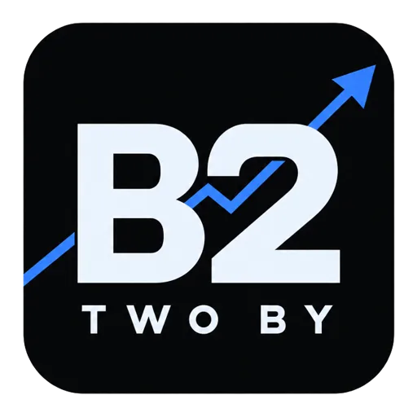

# TWO BY — Plataforma de Mercado Financeiro & Bolsa B3

Plataforma profissional de inteligência e acompanhamento do mercado financeiro brasileiro (B3), desenvolvida com design moderno em tema dark azul-marinho elétrico, terminal financeiro, carrossel cinematográfico com vídeo em loop, cotações ao vivo, gráficos de candlesticks interativos, carteira de investimentos e perfil personalizado de Matheus Peniche.



---

## 🚀 Como Subir para o GitHub e Abrir no Arc Browser

### 1. Criar o Repositório no GitHub
1. Acesse [github.com](https://github.com) e faça login na sua conta.
2. Clique no botão verde **"New"** (ou no `+` no canto superior direito -> **New repository**).
3. No campo **Repository name**, digite: `two-by` (ou `two-by-b3`).
4. Escolha **Public** (Público) ou **Private** (Privado).
5. **Atenção:** Deixe desmarcadas as opções *"Add a README file"*, *"Add .gitignore"* e *"Choose a license"* (já criamos esses arquivos para você).
6. Clique em **Create repository**.

---

### 2. Conectar e Enviar o Projeto para o GitHub
No terminal do seu computador (VS Code ou terminal de sua preferência) na pasta do projeto:

```bash
# 1. Configurar seu usuário do Git (se ainda não tiver configurado)
git config --global user.name "Seu Nome"
git config --global user.email "seu-email@exemplo.com"

# 2. Inicializar o repositório e adicionar os arquivos
git init -b main
git add .
git commit -m "feat: TWO BY B3 Terminal financeiro completo"

# 3. Vincular ao seu repositório remoto do GitHub (substitua pelo seu link gerado)
git remote add origin https://github.com/SEU_USUARIO/two-by.git

# 4. Enviar os arquivos para o GitHub
git push -u origin main
```

---

### 3. Como Rodar e Abrir no Arc Browser

O **Arc Browser** é ideal para uso como terminal de investimentos:

#### Opção A: Executar com Servidor (API B3 ao vivo em tempo real)
```bash
# Instalar as dependências
npm install

# Iniciar o servidor de desenvolvimento
npm run dev
```
Após iniciar, abra o **Arc Browser** e acesse:
👉 `http://localhost:3000`

#### Opção B: Executar 100% Estático (Sem Terminal/Node)
Basta abrir diretamente o arquivo no Arc Browser:
- Pressione `Cmd + O` (no Mac) ou `Ctrl + O` (no Windows) no Arc.
- Selecione o arquivo `index.html` ou `two-by/index.html`.

---

### 4. Dicas de Uso no Arc Browser para Investidores
- **Split View (Divisão de Tela):** No Arc, aperte `+` e arraste uma aba ao lado da outra para comparar o gráfico da Petrobras (`PETR4`) e da Vale (`VALE3`) lado a lado.
- **Pinned Tabs & Spaces:** Crie um Space chamado **"TWO BY Trading"** no Arc para manter a plataforma sempre acessível na barra lateral vertical.
- **Picture-in-Picture:** O vídeo da B3 na plataforma roda fluidamente com aceleração por hardware no Arc.

---

### 5. Como Hospedar Online Gratuitamente (Deploy)

#### No GitHub Pages:
1. No seu repositório no GitHub, vá em **Settings** > **Pages**.
2. Em **Build and deployment** > **Source**, selecione **Deploy from a branch**.
3. Selecione a branch `main` e a pasta `/ (root)`.
4. Clique em **Save**. Em minutos seu link estará no ar: `https://seu-usuario.github.io/two-by/`.

#### Na Vercel (Recomendado para API Express):
1. Acesse [vercel.com](https://vercel.com) e conecte com seu GitHub.
2. Selecione o repositório `two-by`.
3. Clique em **Deploy** com 1 clique.

---

## 🌟 Funcionalidades da Plataforma TWO BY

- 🏙️ **Carrossel Visual Cinemático:** Banners de alta definição e vídeo de skyline financeiro com suporte a arraste por mouse/touch e transição suave sem textos poluídos.
- 📈 **Gráfico de Candlesticks Interativo:** Timeframes (1D, 1S, 1M, 3M, 1A, 5A), crosshair dinâmico, tooltip com abertura, máxima, mínima e fechamento (OHLC) e volume financeiro.
- ⚡ **Dados Reais B3 / Yahoo Finance:** Endpoint proxy `/api/b3/quotes` e `/api/b3/history/:symbol` que busca cotações oficiais e variações percentuais.
- 💼 **Carteira de Investimentos:** Acompanhamento de rentabilidade diária, patrimônio consolidado, posições detalhadas, preço médio e rentabilidade acumulada.
- 👤 **Área do Usuário (Matheus Peniche):**
  - Alteração instantânea de foto de perfil via upload de imagem local.
  - Alternância de contas: **Conta Real** / **Conta Demo**.
  - Modal funcional de Depósito (PIX / TED) e Saque com atualização de saldo em tempo real.
- 🔍 **Busca Inteligente:** Localização rápida por código de ativo (ex: `PETR4`, `VALE3`, `BOVA11`, `HGLG11`) ou nome da empresa.
- 🌙 **Tema Escuro B3:** Azul-marinho elétrico, bordas translúcidas de vidro (glassmorphism), tipografia com números alinhados tabularmente e alto contraste.

---

## 📁 Estrutura de Arquivos

```
two-by/
├── assets/
│   └── aistudio/           # Vídeos em loop, banners em alta resolução e logo B2
├── css/
│   └── style.css           # Estilos modernos em tema azul-escuro com Glassmorphism
├── js/
│   ├── app.js              # Lógica da interface, carrossel, gráficos e modais
│   └── data.js             # Base de dados de ativos da B3 e dados de fallback
├── two-by/                 # Pacote 100% autônomo para abrir direto no navegador
│   ├── index.html
│   ├── css/style.css
│   ├── js/app.js
│   └── assets/
├── index.html              # Interface principal do Terminal TWO BY
├── server.ts               # Servidor Express com rotas de API para cotações reais da B3
├── package.json            # Scripts de execução e dependências
└── README.md               # Este guia completo de instalação e GitHub
```

---

## 👨‍💻 Desenvolvido para TWO BY
Terminal financeiro moderno para acompanhamento de mercado, investimentos e análise técnica na B3.
